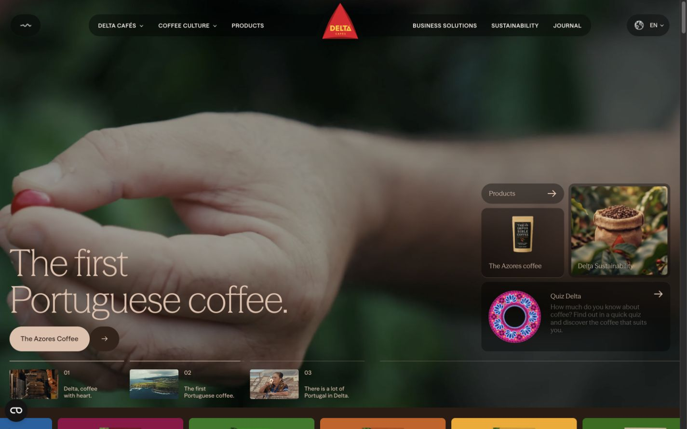

# coffi-konsept · Delta Cafés

[Delta Cafés İngilizce sitesinin](https://deltacafes.com/en) Next.js 16 ile yeniden kurulmuş konsept çalışması. Anasayfa ve 89 iç sayfa önceden oluşturulur; video hero, quiz, interaktif grafikler, Rive/Lottie animasyonları ve fizikli history bölümü React istemci bileşenleriyle çalışır.

**Canlı önizleme:** [coffi-konsept.vercel.app](https://coffi-konsept.vercel.app/en)



## Öne çıkanlar

- **Anasayfa**: video hero, ürün şeridi, history, coffee cycle, D de Delta, coffee culture, quiz, journal, sustainability ve footer.
- **89 iç sayfa**: 36 ürün detayı, journal yazıları, coffee cycle, academy, history, sustainability ve yedi quiz sonuç profili.
- **Quiz**: beş soru, yörünge animasyonları ve referansın puan tablosuna göre sonuç eşleştirmesi.
- **Hareket**: Lenis kaydırma, GSAP/ScrollTrigger geçişleri, history fotoğraf/halat fiziği, görünürlüğe göre başlayan animasyonlar.
- **Etkileşim**: ürün filtreleri, hazırlama galerileri, Chart.js grafikleri, journal kategori ve sayfalama, sürüklenebilir şeritler.
- **Mobil**: alt menüler, footer akordeonları, mobil ürün filtresi.
- Yerel çerez tercihleri. Portekizce dil seçimi, mağaza ve sosyal bağlantılar özgün dış adreslerine açılır.

## Teknolojiler

Next.js 16 (App Router) · React 19 · TypeScript · GSAP / ScrollTrigger · Lenis · Rive · Lottie · Chart.js

Referansın bölüm yapısı ve CSS kuralları korunur; özgün Nuxt çalışma zamanı yüklenmez, etkileşimleri React bileşenleri yönetir.

## Çalıştırma

Node.js 20.9 veya üzeri gerekir.

```bash
npm ci
npm run dev
```

Önizleme: [localhost:3000/en](http://localhost:3000/en)

| Komut | Ne yapar |
|---|---|
| `npm run dev` | Geliştirme sunucusu (`0.0.0.0`, ağdaki cihazlardan erişilebilir) |
| `npm run build` / `npm start` | Üretim derlemesi ve sunucusu |
| `npm run typecheck` | TypeScript kontrolü |

Ortam değişkeni, veritabanı veya CMS bağlantısı gerekmez. Görseller, fontlar, videolar, Rive dosyaları, WASM ve Lottie kaynakları `public/` içindedir.

## Yapı

```text
src/app/                  Next.js rotaları ve ortak stiller
src/components/           Menü, anasayfa, detay sayfaları ve kaydırma
src/components/sections/  Quiz, grafik, medya ve etkileşim modülleri
src/data/                 Sayfa içerikleri ve medya eşleştirmeleri
public/                   Font, görsel, video, animasyon ve CSS
docs/                     Masaüstü ve mobil önizleme görselleri
scripts/                  Referans hazırlama yardımcıları
```

`scripts/`, Git'e eklenmeyen `reference/` yakalamalarıyla çalışır. Uygulamayı kurmak, çalıştırmak veya derlemek için gerekmez.

## Doğrulama

- TypeScript kontrolü ve üretim derlemesi başarılı.
- Anasayfa ve 89 iç sayfa: üretim sunucusunda 91/91 başarılı HTTP kontrolü.
- Masaüstü 1440×900 ve mobil 390×844 tarayıcı kontrolleri ([mobil önizleme](docs/home-mobile.png)).
- Quiz baştan sona, mobil ürün filtresi, journal kategori/sayfalama, menüler ve ürün animasyonları denendi.
- Medya manifestlerinde eksik dosya yok.

## Deploy

Vercel'de Next.js ön ayarıyla, ek yapılandırma olmadan yayınlanır.

## Haklar

Marka, metinler ve görsel/animasyon kaynakları **Delta Cafés**'e, özgün site tasarımı **Büro**'ya aittir. Bu repository bağımsız bir konsept ve teknik çalışmadır; Delta Cafés veya Büro ile bir bağı yoktur.
